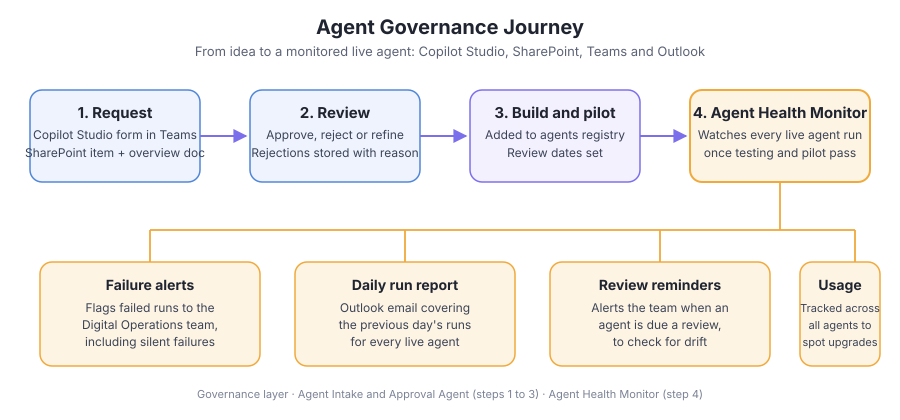

# Agent Health Monitor

Key Result: Silent agent failures identified and flagged to the team
Layer: Governance
Problem: Silent failures on scheduled agent runs
Status: Live

[Home](../../index.html) • [Agent Registry](../../Agent-Registry.html) • [Results](../../Results.html) • [Roadmap](../../Roadmap.html) • [Campaign & Commercial Projects](../../Campaign-Commercial-Projects.html) • [Leadership & Strategy](../../Leadership-%26-Strategy.html) • [How to Build MOCC](../../How-to-Build.html)

---

**Layer:** ⚙️ Governance

**Status:** 🟢Live

**Platform:** Microsoft Copilot Studio • SharePoint • Microsoft Teams • Outlook

**Deployment:** Veriforce — 5 brands

**Last updated:** November 2026

**Version:** 1.0

## Business Problem

Scheduled agents carry the risk of failing silently: a run does not happen or does not complete, and nobody notices until the output is missing. Agent review dates can also slip, so live agents drift without anyone checking them. With a growing number of live agents, there was no single view of whether each one was running as expected.

## Solution Overview

The Agent Health Monitor picks up where the Agent Intake & Approval Agent leaves off. Requests are approved and added to the agents registry with review dates; once an agent has been built and has passed testing and pilot, the Health Monitor starts watching it. It monitors every live agent run and flags any failure to the Digital Operations team, which matters most for scheduled runs where a failure can otherwise go unseen. An Outlook email report covers the previous day's runs, and the team is alerted when an agent is due a review. It is built in Copilot Studio, SharePoint and Teams.

## Business Value

- Failed runs are flagged to the Digital Operations team, including silent failures on scheduled runs
- A daily Outlook email report covers the previous day's runs
- The team is alerted to any agent due an upcoming review, so drift is checked on a set rhythm
- Usage is tracked across all agents, highlighting potential enhancements
- Success is measured by the number of silent failures identified

### Cost Savings

- **Operational impact:** Prevents 1–2 missed reports/month (each potentially causing stakeholder escalation) = est. **£3k–5k impact avoided**
- **Reliability value:** Enables team to trust agents for mission-critical daily/weekly tasks

## Version History

| Version | Date | Milestone |
| --- | --- | --- |
| v1.0 | November 2026 | Monitoring of all live agent runs with failure alerts, a daily Outlook run report, review-due alerts and usage tracking |

## Design Insights

Monitoring starts only after an agent has passed testing and pilot, and it relies on the registry and review dates created at approval. Together with the Agent Intake & Approval Agent, it covers the journey from request to long-term health.

---

## Explore Other MOCC Modules

- [Agent Intake & Approval Agent](../Agent%20Intake%20%26%20Approval%20Agent/Agent-Intake-%26-Approval-Agent.html)
- [CRM Health Agent](../CRM%20Health%20Agent/CRM-Health-Agent.html)
- [Clarity Website Analyst](../Clarity%20Website%20Analyst/Clarity-Website-Analyst.html)
- [Email QA Agent](../Email%20QA%20Agent/Email-QA-Agent.html)
- [Website QA Agent](../Website%20QA%20Agent/Website-QA-Agent.html)
- [Data Import Agent](../Data%20Import%20Agent/Data-Import-Agent.html)
- [Campaign Performance Agent](../Campaign%20Performance%20Agent/Campaign-Performance-Agent.html)
- [Campaign Build Agent](../Campaign%20Build%20Agent/Campaign-Build-Agent.html)
- [Content Agent](../Content%20Agent/Content-Agent.html)
- [WordPress Post Creation Agent](../WordPress%20Post%20Creation%20Agent/WordPress-Post-Creation-Agent.html)
