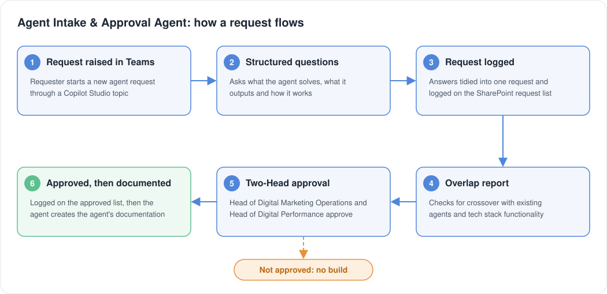

# Agent Intake & Approval Agent

Key Result: Every request logged and approved before build
Layer: Governance
Problem: Uncoordinated agent requests and overlapping builds
Status: Live

[Home](../../index.html) • [Agent Registry](../../Agent-Registry.html) • [Results](../../Results.html) • [Roadmap](../../Roadmap.html) • [Campaign & Commercial Projects](../../Campaign-Commercial-Projects.html) • [Leadership & Strategy](../../Leadership-%26-Strategy.html) • [How to Build MOCC](../../How-to-Build.html) • [HubSpot Expert in South Wales](../../HubSpot-Expert-South-Wales.html)

---

**Layer:** Governance 

**Status:** Live

**Platform:** Microsoft Copilot Studio • Microsoft Teams • SharePoint

**Deployment:** Veriforce — all agent requests 

**Last updated:** October 2026 

## Business Problem

As the number of agents grew, there was no consistent way to capture what a new agent was meant to solve, who had approved it, or how it worked. Requests came in informally, and documentation, where it existed, was written after the build. That made ownership, risk review and long-term visibility harder to maintain.

Functionality was also being built that overlapped with existing agents and tools in the stack.

## Solution Overview

The Agent Intake & Approval Agent is a Copilot Studio topic embedded in Teams. It captures the business challenge, proposed solution, intended outputs and relevant systems, then logs the request in SharePoint. It produces an assessment report highlighting potential overlap with existing agents and functionality already available in the marketing technology stack. The Head of Digital Marketing Operations and Head of Digital Performance review the proposal before any build is approved.

The assessment considers the expected time-saving or wider capability benefit, development effort, reliability, operational risk and governance implications, alongside whether an existing platform can already meet the need. Proposals can proceed to build, be approved for production after testing and acceptance, or be parked for later.

Once approved, the agent generates the supporting documentation and records the request and decision in separate lists. The workflow automates the administration around intake and approval, leaving the requester to provide the initial business requirements and my team to support the build and technical review.

## Business Value

- Every agent request is logged on a SharePoint list, giving a full record of what was asked for
- No agent is built without approval from two Heads
- Proposals are assessed for time-saving or capability value, build effort, reliability, operational risk and governance risk
- Existing marketing technology is checked before any build to avoid duplicating functionality
- Approved agents get documentation created by the agent, so setup and workings stay visible long term
- Requests and approvals sit on separate lists, giving a clear audit trail from request to approval

### Capacity value and other benefits

- **Time reclaimed:** 3 hrs/month = £75/month = **£900/year** at the MOCC's illustrative £25/hour rate. This is an illustrative capacity value, not a direct cash saving
- **Governance value:** Every build is intentional and tracked, creating an auditable approval trail and helping prevent overlapping builds

## Design Insights

Approval happens before build, so value, feasibility, risk and overlap with existing agents or the wider marketing technology stack are considered before development effort is committed. Automating the supporting documentation and records keeps the governance process proportionate for requesters.

---

## Explore Other MOCC Modules

- [Clarity Website Analyst](../Clarity%20Website%20Analyst/Clarity-Website-Analyst.html)
- [Email QA Agent](../Email%20QA%20Agent/Email-QA-Agent.html)
- [Website QA Agent](../Website%20QA%20Agent/Website-QA-Agent.html)
- [Data Import Agent](../Data%20Import%20Agent/Data-Import-Agent.html)
- [CRM Health Agent](../CRM%20Health%20Agent/CRM-Health-Agent.html)
- [Campaign Performance Agent](../Campaign%20Performance%20Agent/Campaign-Performance-Agent.html)
- [Campaign Build Agent](../Campaign%20Build%20Agent/Campaign-Build-Agent.html)
- [Content Agent](../Content%20Agent/Content-Agent.html)
- [WordPress Post Creation Agent](../WordPress%20Post%20Creation%20Agent/WordPress-Post-Creation-Agent.html)
- [Agent Health Monitor](../Agent%20Health%20Monitor/Agent-Health-Monitor.html)
