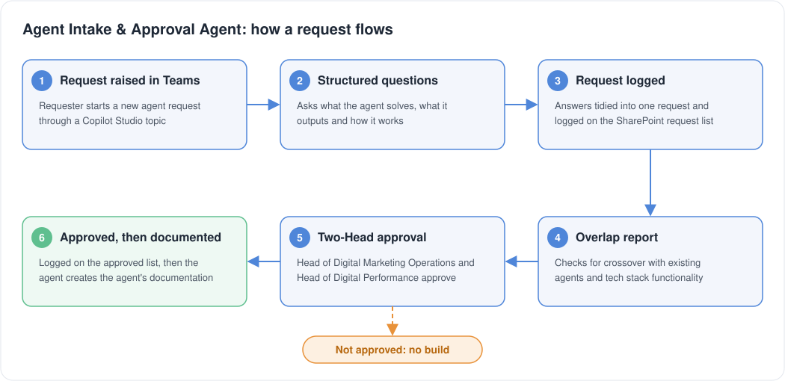

# Agent Intake & Approval Agent

Key Result: Every request logged and approved before build
Layer: Governance
Problem: Uncoordinated agent requests and overlapping builds
Status: Live

[Home](../../index.html) • [Agent Registry](../../Agent-Registry.html) • [Results](../../Results.html) • [Roadmap](../../Roadmap.html) • [Campaign & Commercial Projects](../../Campaign-Commercial-Projects.html) • [Leadership & Strategy](../../Leadership-%26-Strategy.html) • [How to Build MOCC](../../How-to-Build.html) • [HubSpot Expert in South Wales](../../HubSpot-Expert-South-Wales.html)

---

**Layer:** ⚙️ Governance  

**Status:** 🟢Live

**Platform:** Microsoft Copilot Studio • Microsoft Teams • SharePoint

**Deployment:** Veriforce — all agent requests  

**Last updated:** October 2026  

## Business Problem

As the number of agents grew, there was no consistent way to capture what a new agent was meant to solve, who had approved it, or how it worked. Requests came in informally, and documentation, where it existed, was written after the build. That made ownership, risk review and long-term visibility harder to maintain.

Functionality was also being built that overlapped with existing agents and tools in the stack.

## Solution Overview

The Agent Intake & Approval Agent is a Copilot Studio topic embedded in Teams. It asks the requester structured questions about what the agent helps solve, what it outputs and how it works, and tidies the answers into a single request. Every request is logged on a SharePoint list. The agent then produces a report for the approvers showing any potential crossover with existing agents and existing tech stack functionality. The request and report go to the Head of Digital Marketing Operations and the Head of Digital Performance for approval before any build. Approved requests are logged on an approved list, and the agent then creates the agent's documentation so its setup and workings stay visible over the long term.

## Business Value

- Every agent request is logged on a SharePoint list, giving a full record of what was asked for
- No agent is built without approval from two Heads
- Approvers see potential overlap with existing agents and stack functionality before any build starts
- Approved agents get documentation created by the agent, so setup and workings stay visible long term
- Requests and approvals sit on separate lists, giving a clear audit trail from request to approval

### Cost Savings

- **Prevented rework:** ~20% of pre-system requests were duplicates = est. 40 hrs prevented = **£4,800/year**
- **Governance value:** Every build is intentional + tracked; easy to audit for compliance

## Design Insights

Approval happens before build, so overlap with existing agents and tools is caught before any time is spent building.

---

## Explore Other MOCC Modules

- [Clarity Website Analyst](../Clarity%20Website%20Analyst/Clarity-Website-Analyst.html)
- [Email QA Agent](../Email%20QA%20Agent/Email-QA-Agent.html)
- [Website QA Agent](../Website%20QA%20Agent/Website-QA-Agent.html)
- [Data Import Agent](../Data%20Import%20Agent/Data-Import-Agent.html)
- [CRM Health Agent](../CRM%20Health%20Agent/CRM-Health-Agent.html)
- [Campaign Performance Agent](../Campaign%20Performance%20Agent/Campaign-Performance-Agent.html)
- [Campaign Build Agent](../Campaign%20Build%20Agent/Campaign-Build-Agent.html)
- [Content Agent](../Content%20Agent/Content-Agent.html)
- [WordPress Post Creation Agent](../WordPress%20Post%20Creation%20Agent/WordPress-Post-Creation-Agent.html)
- [Agent Health Monitor](../Agent%20Health%20Monitor/Agent-Health-Monitor.html)
