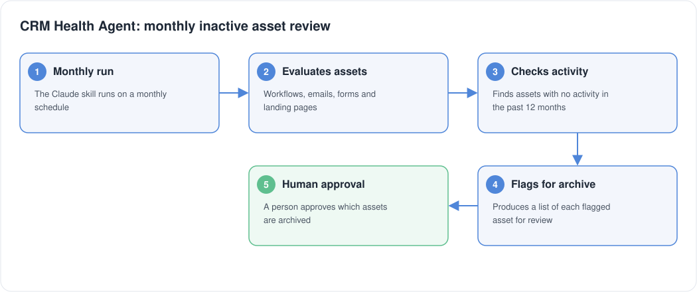

# CRM Health Agent

Key Result: Monthly list of inactive assets flagged for archive approval
Layer: Governance
Problem: Inactive CRM assets building up
Status: Live

[Home](../../index.html) • [Agent Registry](../../Agent-Registry.html) • [Results](../../Results.html) • [Roadmap](../../Roadmap.html) • [Campaign & Commercial Projects](../../Campaign-Commercial-Projects.html) • [Leadership & Strategy](../../Leadership-%26-Strategy.html) • [How to Build MOCC](../../How-to-Build.html) • [HubSpot Expert in South Wales](../../HubSpot-Expert-South-Wales.html)

---

**Layer:** Governance

**Status:** Live

**Platform:** Claude (Claude Skill)

**Deployment:** Veriforce — 5 brands

**Live since:** September 2026

**Last updated:** October 2026

**Version:** 1.0

## Business Problem

Workflows, emails, forms and landing pages that have had no activity for 12 months or more build up in the CRM. Left alone, they add technical debt and make it harder to see what is actually in use.

## Solution Overview

The CRM Health Agent is a Claude Skill that runs every month. It evaluates workflows, emails, forms and landing pages, finds any that have had no activity in the past 12 months, and flags a list of each asset for human archive approval. Nothing is archived without a person approving it.

It brings workflow, email and forms governance together under one agent.

## Business Value

- One monthly run covers workflows, emails, forms and landing pages
- Every asset with no activity in the past 12 months is flagged, so nothing inactive is missed
- Archiving stays a human decision, with the agent supplying the list
- Workflow, email and forms governance sit under a single agent rather than three

### Cost Savings

- **Time reclaimed:** 8 hrs/month = £200/month = **£2,400/year** at the MOCC's illustrative £25/hour rate
- **Compliance value:** Prevents audit findings on stale asset accumulation; reduces operational risk

## Version History

| Version | Date | Milestone |
| --- | --- | --- |
| v1.0 | September 2026 | Monthly review of workflows, emails, forms and landing pages with no activity in 12 months, flagged for human archive approval |

## Design Insights

Combining the asset types under one agent keeps governance in a single monthly review. The agent finds and flags, and a person approves every archive.

---

## Explore Other MOCC Modules

- [Agent Intake & Approval Agent](../Agent%20Intake%20%26%20Approval%20Agent/Agent-Intake-%26-Approval-Agent.html)
- [Clarity Website Analyst](../Clarity%20Website%20Analyst/Clarity-Website-Analyst.html)
- [Email QA Agent](../Email%20QA%20Agent/Email-QA-Agent.html)
- [Website QA Agent](../Website%20QA%20Agent/Website-QA-Agent.html)
- [Data Import Agent](../Data%20Import%20Agent/Data-Import-Agent.html)
- [Campaign Performance Agent](../Campaign%20Performance%20Agent/Campaign-Performance-Agent.html)
- [Campaign Build Agent](../Campaign%20Build%20Agent/Campaign-Build-Agent.html)
- [Content Agent](../Content%20Agent/Content-Agent.html)
- [WordPress Post Creation Agent](../WordPress%20Post%20Creation%20Agent/WordPress-Post-Creation-Agent.html)
- [Agent Health Monitor](../Agent%20Health%20Monitor/Agent-Health-Monitor.html)
