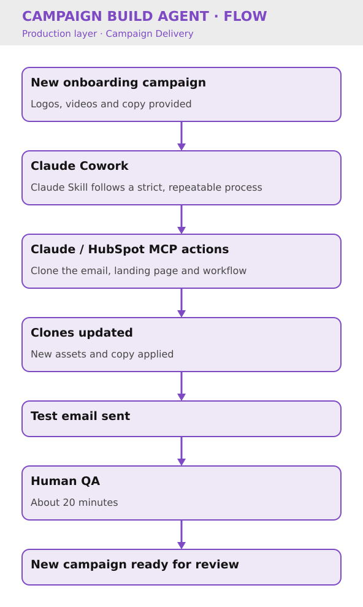

# Campaign Build Agent

Key Result: 60 minutes saved per campaign build
Layer: Production
Problem: Manual Campaign Cloning & Asset Updates
Status: Live

[Home](../../index.html) • [Agent Registry](../../Agent-Registry.html) • [Results](../../Results.html) • [Roadmap](../../Roadmap.html) • [Campaign & Commercial Projects](../../Campaign-Commercial-Projects.html) • [Leadership & Strategy](../../Leadership-%26-Strategy.html) • [How to Build MOCC](../../How-to-Build.html)

---

**Layer:** 🏗️ Production — Campaign Delivery  

**Status:** 🟢 Live

**Platform:** Claude Cowork · Claude Skill · Claude/HubSpot MCP Actions

**Deployment:** Veriforce — 1 brand (onboarding campaigns)

**Last updated:** September 2026

**Version:** 1.1

## Business Problem

Building a new campaign from an existing template required manually cloning each asset (email, landing page, workflow) and updating them one by one with new creative, logos, videos, and copy, then rebuilding the workflow logic each time. This was repetitive and time-consuming for every new campaign launch.

## Solution Overview

Using Claude Cowork alongside Claude/HubSpot MCP actions, the agent clones an existing campaign template (email, landing page and workflow) and updates it with newly provided assets (logos, videos, copy), producing a fully built new campaign ready for review, removing the manual cloning and asset-swapping work previously done by hand. The build runs as a Claude Skill following a strict, repeatable process for onboarding campaigns: about 10 minutes of agent time followed by about 20 minutes of human QA.

## Business Value

- Saves approximately **60 minutes of manual execution time per campaign** (about 30 minutes with the agent and human QA, versus about 90 minutes manually), roughly 4 hours a month at 4 campaigns a month
- Removes repetitive manual cloning and asset-swapping work
- Speeds up campaign delivery time
- Reduces risk of manual copy/paste errors when rebuilding assets

### Cost Savings

- **Time reclaimed (pilot):** 16 hrs/month per brand = **£19,200/year**
- **Projected if scaled to 5 brands:** 80 additional hrs/month = **£96,000/year**
- **Secondary benefit:** Standardizes campaign quality across brands; reduces approval cycles

## Version History

| Version | Date | Milestone |
| --- | --- | --- |
| 1.0 | July 2026 | Initial live version: clones email, landing page and workflow templates, updates with provided assets, and creates new campaign |
| 1.1 | September 2026 | Build time reduced and test email send added |

## Design Insights

Building this on Claude Cowork with HubSpot MCP actions meant the same underlying architecture used for read-only insight generation (Campaign Performance Agent) could be extended into write/create actions, cloning and updating live campaign assets directly rather than needing separate bespoke automation for each asset type.

---

## Explore Other MOCC Modules

- [Clarity Website Analyst](../Clarity%20Website%20Analyst/Clarity-Website-Analyst.html)
- [Email QA Agent](../Email%20QA%20Agent/Email-QA-Agent.html)
- [Website QA Agent](../Website%20QA%20Agent/Website-QA-Agent.html)
- [Data Import Agent](../Data%20Import%20Agent/Data-Import-Agent.html)
- [Agent Intake & Approval Agent](../Agent%20Intake%20%26%20Approval%20Agent/Agent-Intake-%26-Approval-Agent.html)
- [CRM Health Agent](../CRM%20Health%20Agent/CRM-Health-Agent.html)
- [Campaign Performance Agent](../Campaign%20Performance%20Agent/Campaign-Performance-Agent.html)
- [Content Agent](../Content%20Agent/Content-Agent.html)
- [WordPress Post Creation Agent](../WordPress%20Post%20Creation%20Agent/WordPress-Post-Creation-Agent.html)

- [Agent Health Monitor](../Agent%20Health%20Monitor/Agent-Health-Monitor.html)
