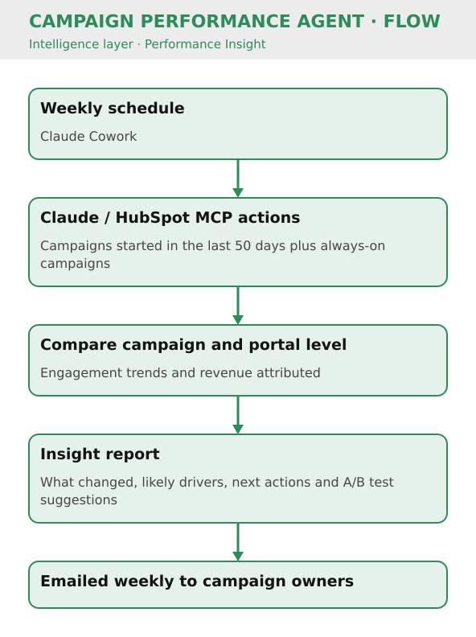

# Campaign Performance Agent

Key Result: Weekly campaign & portal-level insights with A/B test suggestions
Layer: Intelligence
Problem: Manual, Fragmented Campaign Reporting
Status: Live

[Home](../../index.html) • [Agent Registry](../../Agent-Registry.html) • [Results](../../Results.html) • [Roadmap](../../Roadmap.html) • [Campaign & Commercial Projects](../../Campaign-Commercial-Projects.html) • [Leadership & Strategy](../../Leadership-%26-Strategy.html) • [How to Build MOCC](../../How-to-Build.html) • [HubSpot Expert in South Wales](../../HubSpot-Expert-South-Wales.html)

---

**Layer:** Intelligence — Performance Insight 

**Status:** Live 

**Platform:** Claude Cowork · Claude/HubSpot MCP Actions 

**Deployment:** Veriforce — 5 brands 

**Last updated:** September 2026 

**Version:** 2.0 

## Business Problem

Campaign performance insights are often slow and fragmented across channels, making it difficult to understand what’s working, what’s driving pipeline, and where to optimise. Reporting tends to be manual and retrospective rather than proactive.

## Solution Overview

The Campaign Performance Agent runs weekly across campaigns started in the last 50 days plus always-on campaigns, comparing performance at campaign and portal level to surface successes, concerns, engagement trends, revenue attributed and A/B test suggestions. It generates a standard insight report that highlights what changed, likely drivers and recommended next actions, and the report is emailed weekly to campaign owners, turning performance data into decision-ready insight.

## Business Value

- Faster time-to-insight with less manual reporting
- Coverage of always-on campaigns as well as time-bound campaigns
- A/B test suggestions to support a more consistent optimisation loop
- Insights shared directly with campaign owners, so they reach the people who can act on them
- Engagement trends shown alongside revenue attributed, giving stakeholders a clearer performance narrative

### Cost Savings

- **Time reclaimed:** 2 hrs/month = £50/month = **£600/year** at the MOCC's illustrative £25/hour rate
- **Secondary benefit:** More data-driven campaign decisions; faster optimization cycles

## Version History

| Version | Date | Milestone |
| --- | --- | --- |
| 0.1 | May 2026 | Design draft (inputs, outputs, cadence defined) |
| 1.0 | July 2026 | Initial live version: reporting on live campaigns started in the previous 50 days |
| 2.0 | September 2026 | Reworked to cover always-on campaigns and A/B test suggestions; report now shared internally with campaign owners |

## Design Insights

Insight outputs should be “decision first”: lead with the few changes that matter, show supporting evidence, and end with recommended actions—otherwise the agent becomes just another dashboard.

---

## Explore Other MOCC Modules

- [Clarity Website Analyst](../Clarity%20Website%20Analyst/Clarity-Website-Analyst.html)
- [Email QA Agent](../Email%20QA%20Agent/Email-QA-Agent.html)
- [Website QA Agent](../Website%20QA%20Agent/Website-QA-Agent.html)
- [Data Import Agent](../Data%20Import%20Agent/Data-Import-Agent.html)
- [Agent Intake & Approval Agent](../Agent%20Intake%20%26%20Approval%20Agent/Agent-Intake-%26-Approval-Agent.html)
- [CRM Health Agent](../CRM%20Health%20Agent/CRM-Health-Agent.html)
- [Campaign Performance Agent](Campaign-Performance-Agent.html)
- [Campaign Build Agent](../Campaign%20Build%20Agent/Campaign-Build-Agent.html)
- [Content Agent](../Content%20Agent/Content-Agent.html)
- [WordPress Post Creation Agent](../WordPress%20Post%20Creation%20Agent/WordPress-Post-Creation-Agent.html)

- [Agent Health Monitor](../Agent%20Health%20Monitor/Agent-Health-Monitor.html)
