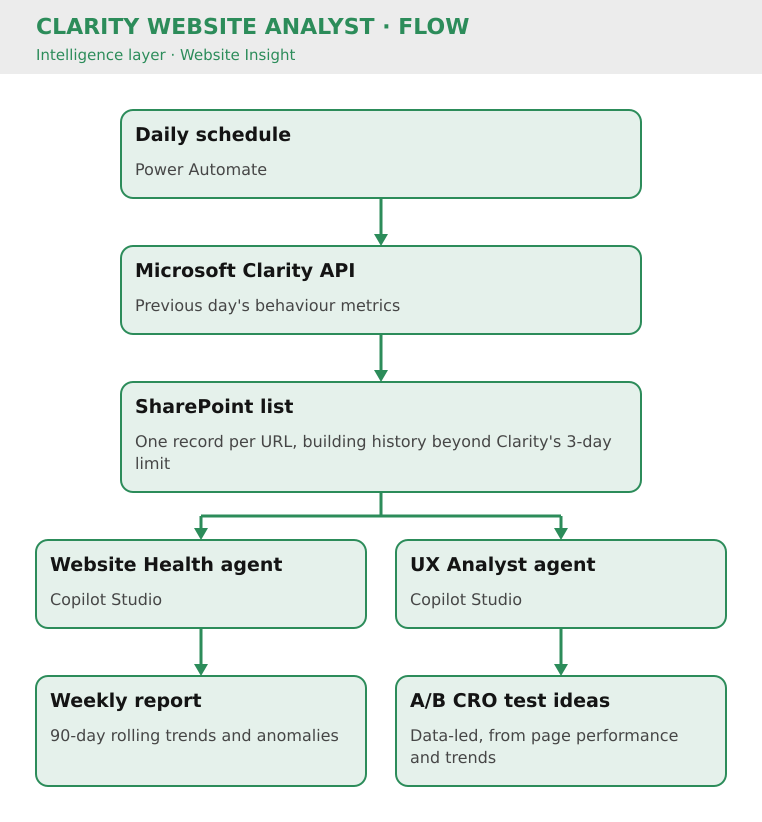

# Clarity Website Analyst

Key Result: Data-led insight into website UX: 90-day rolling trends and A/B CRO test ideas
Layer: Intelligence
Problem: No Long-Term View of On-Site Behaviour
Status: Live

[Home](../../index.html) • [Agent Registry](../../Agent-Registry.html) • [Results](../../Results.html) • [Roadmap](../../Roadmap.html) • [Campaign & Commercial Projects](../../Campaign-Commercial-Projects.html) • [Leadership & Strategy](../../Leadership-%26-Strategy.html) • [How to Build MOCC](../../How-to-Build.html)

---

**Layer:** 📈 Intelligence — Website Insight  

**Status:** 🟢 Live  

**Platform:** Microsoft Clarity API · Power Automate · SharePoint · Microsoft Copilot Studio  

**Deployment:** Veriforce — 5 brands  

**Last updated:** October 2026  

**Version:** v1.0  

## Business Problem

Website UX decisions were being made without a long-term view of how visitors actually behave. Microsoft Clarity's API only exposes the last 3 days of behaviour data, so signals such as rage clicks, dead clicks, time on page and scroll depth were hard to track over time, and UX issues or optimisation opportunities could go unnoticed. Without that history, A/B test ideas were harder to ground in evidence.

## Solution Overview

The Clarity Website Analyst turns raw behaviour data into data-led insight on website UX.

A scheduled workflow runs every morning, collects the previous day's Clarity metrics (pageviews, rage clicks, dead clicks, time on page, scroll rate and more) and stores them against each URL in a SharePoint list, building a history that goes beyond Clarity's 3-day limit.

Copilot Studio then reads this list with two agents:

- **Website Health agent:** delivers 90-day rolling trends and flags anomalies in a weekly report, such as click spikes or traffic drops on key pages.
- **UX Analyst agent:** suggests data-led A/B CRO test ideas based on page performance and the 90-day rolling trends.

## Flow

## Business Value

- Saves approximately **10 hours per month**
- Builds a long-term behavioural dataset beyond Clarity's 3-day window, enabling 90-day rolling trends
- Surfaces UX friction per URL, such as rage clicks, dead clicks, scroll depth and time on page
- Flags anomalies in a weekly report, so issues are spotted without manually checking dashboards
- Turns the data into A/B CRO test ideas, grounding website optimisation in evidence
- Runs across all 5 brand sites from one repeatable foundation

### Cost Savings

- **Time reclaimed:** 10 hrs/month (data collection + manual analysis) = **£12,000/year**
- **Secondary benefit:** CRO decisions are now data-driven vs. gut-feel; faster conversion optimization

## Version History

| Version | Date | Milestone |
| --- | --- | --- |
| v1.0 | October 2026 | Live on 5 brands: daily Clarity ingestion, 90-day rolling trends and data-led A/B CRO test ideation |

## Design Insights

Saving each day's snapshot turns a short-lived API window into a growing dataset, so the same agents can look at trends rather than a single moment.

Pairing trend reporting with test ideation in the same system keeps UX recommendations tied to evidence: the report shows where behaviour changed, and the UX Analyst proposes what to test next.

---

## Explore Other MOCC Modules

- [Agent Intake & Approval Agent](../Agent%20Intake%20%26%20Approval%20Agent/Agent-Intake-%26-Approval-Agent.html)
- [Email QA Agent](../Email%20QA%20Agent/Email-QA-Agent.html)
- [Website QA Agent](../Website%20QA%20Agent/Website-QA-Agent.html)
- [Campaign Build Agent](../Campaign%20Build%20Agent/Campaign-Build-Agent.html)
- [Content Agent](../Content%20Agent/Content-Agent.html)
- [WordPress Post Creation Agent](../WordPress%20Post%20Creation%20Agent/WordPress-Post-Creation-Agent.html)
- [Data Import Agent](../Data%20Import%20Agent/Data-Import-Agent.html)
- [Campaign Performance Agent](../Campaign%20Performance%20Agent/Campaign-Performance-Agent.html)
- [Agent Health Monitor](../Agent%20Health%20Monitor/Agent-Health-Monitor.html)
