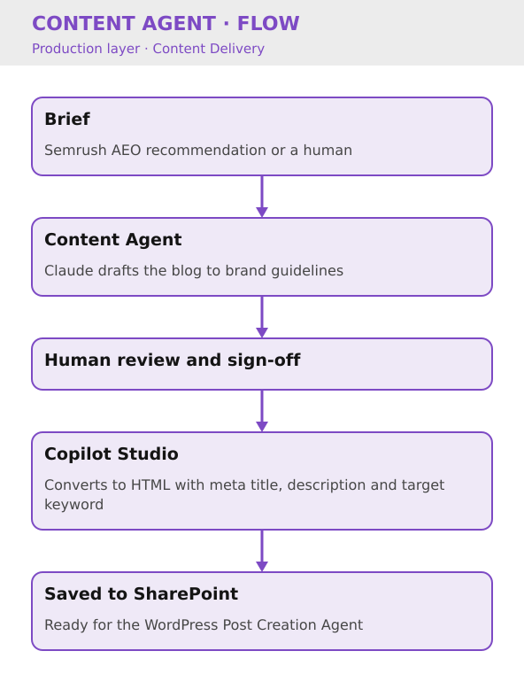

# Content Agent

Key Result: Agency spend cut from £20k to £10k a month
Layer: Production
Problem: Manual Content Briefing & Drafting
Status: Live

[Home](../../index.html) • [Agent Registry](../../Agent-Registry.html) • [Results](../../Results.html) • [Roadmap](../../Roadmap.html) • [Campaign & Commercial Projects](../../Campaign-Commercial-Projects.html) • [Leadership & Strategy](../../Leadership-%26-Strategy.html) • [How to Build MOCC](../../How-to-Build.html) • [HubSpot Expert in South Wales](../../HubSpot-Expert-South-Wales.html)

---

**Layer:** 🏗️ Production — Content Delivery  

**Status:** 🟢 Live  

**Platform:** Semrush AEO · Claude · Human Sign-off · Copilot Studio (HTML conversion) · SharePoint  

**Deployment:** Veriforce — 5 brands  

**Last updated:** September 2026  

**Version:** 1.2

## Business Problem

Blog content was briefed and drafted almost entirely through an external agency, at significant recurring cost and with turnaround times dependent on agency capacity. Briefs originated either from a human or from ad-hoc SEO recommendations, with no standardised drafting or metadata process.

The objective was to bring first-draft content production in-house without compromising quality or the human review step needed before publication.

## Solution Overview

The Content Agent is briefed either via Semrush AEO recommendations or directly by a human, taking a blog title and rough brief as input. It produces a full blog draft following brand guidelines, which is sent to a human for review and sign-off. Once approved, Copilot Studio converts the content to HTML, including meta title, meta description and target keyword, and uploads it to SharePoint, ready for the WordPress Post Creation Agent.

## Business Value

- Reduced external content agency spend from £20k to £10k a month
- Faster turnaround from brief to review-ready draft
- Standardised, SEO-ready metadata generated automatically
- Preserved human sign-off as a quality gate before publication
- Created a repeatable pipeline feeding directly into the WordPress Post Creation Agent

### Cost Savings

- **Direct agency spend reduction:** £10k/month = **£120,000/year**
- **Time reclaimed:** 24 hrs/month (content QA + coordination) = £2,400/month
- **Secondary benefit:** In-house content capability created; team no longer dependent on external vendor

## Version History

| Version | Date | Milestone |
| --- | --- | --- |
| v1.0 | June 2026 | Initial version: drafts copy for a post from a brief |
| v1.1 | July 2026 | HTML output added |
| v1.2 | September 2026 | Briefing, drafting, human review and HTML/metadata conversion live |

## Design Insights

Keeping the human review and sign-off step intact was key to trust in the output. The agent takes on the drafting and formatting, and editorial control stays with people.

Generating HTML and SEO metadata (title, description, keyword) as part of the same step removed a separate agency task and made the draft immediately ingestion-ready for WordPress.

---

## Explore Other MOCC Modules

- [Agent Intake & Approval Agent](../Agent%20Intake%20%26%20Approval%20Agent/Agent-Intake-%26-Approval-Agent.html)
- [Campaign Build Agent](../Campaign%20Build%20Agent/Campaign-Build-Agent.html)
- [WordPress Post Creation Agent](../WordPress%20Post%20Creation%20Agent/WordPress-Post-Creation-Agent.html)
- [Clarity Website Analyst](../Clarity%20Website%20Analyst/Clarity-Website-Analyst.html)
- [Email QA Agent](../Email%20QA%20Agent/Email-QA-Agent.html)
- [Website QA Agent](../Website%20QA%20Agent/Website-QA-Agent.html)
- [Data Import Agent](../Data%20Import%20Agent/Data-Import-Agent.html)
- [CRM Health Agent](../CRM%20Health%20Agent/CRM-Health-Agent.html)
- [Campaign Performance Agent](../Campaign%20Performance%20Agent/Campaign-Performance-Agent.html)
- [Agent Health Monitor](../Agent%20Health%20Monitor/Agent-Health-Monitor.html)
