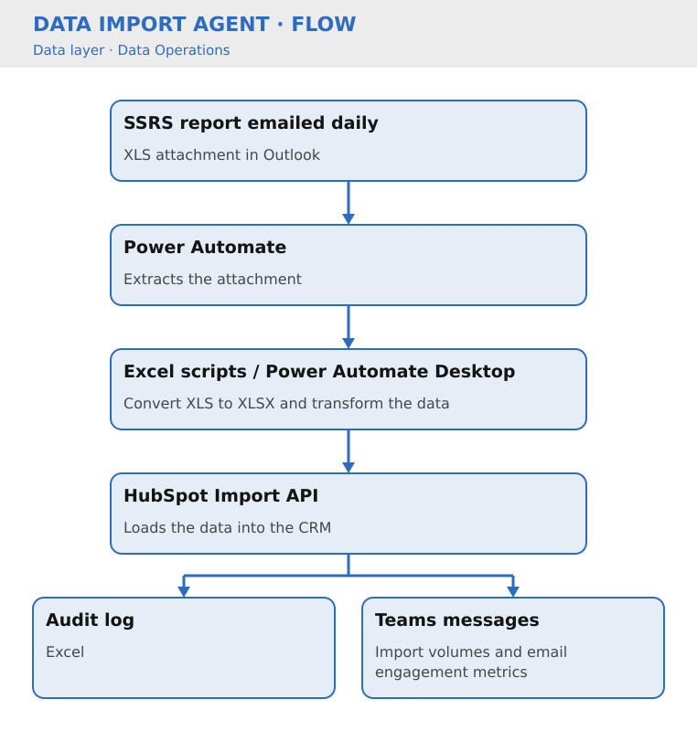

# Data Import Agent

Key Result: 15 hours/month saved via automation
Layer: Data
Problem: Manual SSRS Report Ingestion
Status: Live

[🏠 Home](../../index.html) · [🧩 Agent Registry](../../Agent-Registry.html) · [📈 Results](../../Results.html) · [🗺️ Roadmap](../../Roadmap.html) · [💼 Campaign & Commercial Projects](../../Campaign-Commercial-Projects.html) · [👥 Leadership & Strategy](../../Leadership-%26-Strategy.html) · [🔧 How to Build MOCC](../../How-to-Build.html) · 

---

**Layer:** 🗄️ Data  

**Status:** 🟢Live

**Platform:** Microsoft Outlook • Power Automate • SharePoint • HubSpot CRM • HubSpot Import API

**Deployment:** Veriforce — all brands and products  

**Last updated:** September 2026  

**Version:** 1.4

## Business Problem

SSRS reports are delivered daily as an email attachment in legacy XLS format. The existing process required manual downloading, file conversion, spreadsheet transformation, HubSpot import configuration and validation.

The process consumed significant operational effort, introduced unnecessary risk of human error and lacked a repeatable audit trail.

The objective was to establish a fully auditable automated workflow capable of processing daily renewal data with minimal human intervention.

## Solution Overview

The Data Import Agent standardises XLS preparation and ingestion. It converts and transforms the file via Excel scripts, and the HubSpot Import API then loads the data into the CRM, enabling governed, repeatable ingestion with clear auditability. Teams messages then post import volumes and email engagement metrics for any subsequent emails triggered by the import to team channels, keeping key stakeholders updated. 

## Business Value

- Eliminated manual download and import
- Automated XLS → XLSX conversion and data transformation
- Standardised HubSpot contact updates
- Established auditable import history via Excel logging
- Now processes **13 SSRS reports a week** (delivered daily), reducing operational effort by approximately **15 hours per month**
- Improved data consistency and import reliability
- Created scalable architecture for future API-driven data imports

*Methodology: before automation, each daily report required manual download, conversion, transformation, HubSpot import and validation. Every step is now automated end-to-end, from extraction through to audit logging.*

### Cost Savings

- **Time reclaimed:** 15 hrs/month = £1,500/month = **£18,000/year**
- **Error reduction:** Prevents CRM data quality issues (estimated cost of bad data: £5k/incident × ~2 incidents/year prevented = £10k)
- **Secondary benefit:** Data Import Agent is the backbone for all downstream intelligence; ensures all other agents work with clean data

## Version History

| Version | Date | Milestone |
| --- | --- | --- |
| v1.0 | June 2026 | SSRS attachment extraction automated |
| v1.1 | July 2026 | Power Automate Desktop transformation process implemented |
| v1.2 | July 2026 | HubSpot Import API integration completed |
| v1.3 | July 2026 | Audit logging |
| v1.4 | September 2026 | Import volumes and email engagement metrics posted to team channels |

## Design Insights

The largest efficiency gains came from process orchestration across existing platforms.

A hybrid architecture combining Power Automate, Power Automate Desktop and the HubSpot Import API proved more resilient than attempting to automate browser-based import activities.

The introduction of audit logging provided governance and traceability without materially increasing solution complexity.

---

## Explore Other MOCC Modules

- [Clarity Website Analyst](../Clarity%20Website%20Analyst/Clarity-Website-Analyst.html)
- [Email QA Agent](../Email%20QA%20Agent/Email-QA-Agent.html)
- [Website QA Agent](../Website%20QA%20Agent/Website-QA-Agent.html)
- [Data Import Agent](Data-Import-Agent.html)
- [Agent Intake & Approval Agent](../Agent%20Intake%20%26%20Approval%20Agent/Agent-Intake-%26-Approval-Agent.html)
- [CRM Health Agent](../CRM%20Health%20Agent/CRM-Health-Agent.html)
- [Campaign Performance Agent](../Campaign%20Performance%20Agent/Campaign-Performance-Agent.html)
- [Campaign Build Agent](../Campaign%20Build%20Agent/Campaign-Build-Agent.html)
- [Content Agent](../Content%20Agent/Content-Agent.html)
- [WordPress Post Creation Agent](../WordPress%20Post%20Creation%20Agent/WordPress-Post-Creation-Agent.html)
- [Agent Health Monitor](../Agent%20Health%20Monitor/Agent-Health-Monitor.html)