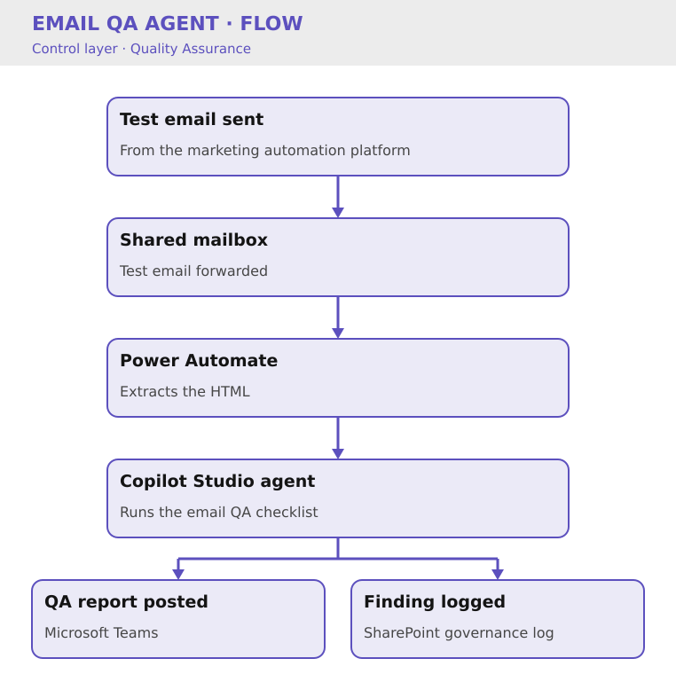

# Email QA Agent

Key Result: 80% reduction in manual QA effort
Layer: Control
Problem: QA Bottlenecks
Status: Live

[Home](../../index.html) • [Agent Registry](../../Agent-Registry.html) • [Results](../../Results.html) • [Roadmap](../../Roadmap.html) • [Campaign & Commercial Projects](../../Campaign-Commercial-Projects.html) • [Leadership & Strategy](../../Leadership-%26-Strategy.html) • [How to Build MOCC](../../How-to-Build.html)

---

**Layer:** 🛡️ Control — Quality Assurance

**Status:** 🟢 Live

**Platform:** Microsoft Copilot Studio · Power Automate · SharePoint · Microsoft Teams · Marketing Automation Platform

**Deployment:** Veriforce — 5 brands 

**Last updated:** June 2026

**Version:** 1.3

## Business Problem

Marketing email QA relied on manual review across multiple stakeholders. Checks varied between reviewers, findings were not centrally recorded, and quality assurance often became a bottleneck before campaign deployment.

The objective was to create a repeatable, auditable and low-friction QA process that could be adopted consistently by the Marketing Operations team.

## Solution Overview

The Email QA Agent automates the pre-send validation of marketing emails by analysing test emails before deployment. A standard test email is forwarded from any marketing automation platform to a shared mailbox, triggering a Power Automate workflow that extracts the HTML and invokes a Microsoft Copilot Studio agent. The resulting QA report is automatically published to Microsoft Teams and recorded in a SharePoint governance log.

## Business Value

- Reduced manual QA effort by approximately **80%**
- Reduced campaign deployment time through automation
- Established an auditable QA history via SharePoint
- Standardised quality assurance across all campaigns
- Increased confidence prior to campaign deployment

*Methodology: based on 4 weeks of before/after data. Prior process averaged ~30 hours/month (3 reviewers, ~30 minutes per email check).*

### Cost Savings

- **Time reclaimed:** 8 hrs/month per brand = 40 hrs/month across 5 brands = £4,800/month = **£57,600/year**
- **Compliance risk reduced:** Audit trail prevents regulatory gaps
- **Secondary benefit:** Marketing Automation Executive freed to focus on workflow strategy instead of checklist work

## Version History

| Version | Date | Milestone |
| --- | --- | --- |
| v1.0 | March 2026 | Initial prototype using manual HTML submission |
| v1.1 | April 2026 | Simplified submission via shared mailbox |
| v1.2 | June 2026 | Event-driven automation with Power Automate |
| v1.3 | June 2026 | Governance reporting to Teams & SharePoint |

## Design Insights

The largest improvement came from reducing user friction.

Early versions required manual uploads of screenshots and HTML. By redesigning the workflow around a shared mailbox and event-driven automation, the user experience became almost invisible. Marketing users now complete QA simply by sending a standard HubSpot test email, allowing the automation to fit naturally into existing campaign processes rather than requiring new behaviours.

---

## Explore Other MOCC Modules

- Agent Health Monitor: [Agent Health Monitor](../Agent%20Health%20Monitor/Agent-Health-Monitor.html)
- Agent Intake & Approval Agent: [Agent Intake & Approval Agent](../Agent%20Intake%20%26%20Approval%20Agent/Agent-Intake-%26-Approval-Agent.html)
- CRM Health Agent: [CRM Health Agent](../CRM%20Health%20Agent/CRM-Health-Agent.html)
- Campaign Build Agent: [Campaign Build Agent](../Campaign%20Build%20Agent/Campaign-Build-Agent.html)
- Campaign Performance Agent: [Campaign Performance Agent](../Campaign%20Performance%20Agent/Campaign-Performance-Agent.html)
- Clarity Website Analyst: [Clarity Website Analyst](../Clarity%20Website%20Analyst/Clarity-Website-Analyst.html)
- Content Agent: [Content Agent](../Content%20Agent/Content-Agent.html)
- Data Import Agent: [Data Import Agent](../Data%20Import%20Agent/Data-Import-Agent.html)
- Email QA Agent: [Email QA Agent](Email-QA-Agent.html)
- Website QA Agent: [Website QA Agent](../Website%20QA%20Agent/Website-QA-Agent.html)
- WordPress Post Creation Agent: [WordPress Post Creation Agent](../WordPress%20Post%20Creation%20Agent/WordPress-Post-Creation-Agent.html)
