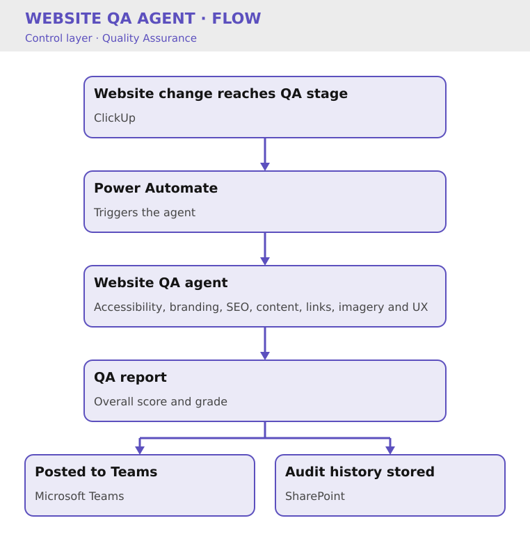

# Website QA Agent

Key Result: 40% reduction in manual review effort
Layer: Control
Problem: Pre-Launch Errors
Status: Live

[Home](../../index.html) • [Agent Registry](../../Agent-Registry.html) • [Results](../../Results.html) • [Roadmap](../../Roadmap.html) • [Campaign & Commercial Projects](../../Campaign-Commercial-Projects.html) • [Leadership & Strategy](../../Leadership-%26-Strategy.html) • [How to Build MOCC](../../How-to-Build.html) • [HubSpot Expert in South Wales](../../HubSpot-Expert-South-Wales.html)

---

**Layer:** 🛡️ Control — Quality Assurance  

**Status:** 🟢 Live  

**Platform:** Microsoft Copilot Studio · Power Automate · Microsoft Teams · Website/CMS  

**Deployment:** Veriforce — 5 brands  

**Last updated:** July 2026  

**Version:** 1.2  

## Business Problem

Website quality assurance relied on manual review prior to publication, with no consistent checklist or audit trail. Errors such as broken links, missing metadata, accessibility issues and inconsistent branding could easily be overlooked, resulting in avoidable defects reaching production.

The objective was to create a repeatable website QA process that improves consistency, reduces manual effort and provides a documented record of every review.

## Solution Overview

The Website QA Agent analyses webpages prior to publication. When a website change reaches the QA stage in ClickUp, Power Automate automatically triggers the agent, which evaluates the page against a defined quality framework covering accessibility, branding, SEO fundamentals, content quality, links, imagery and user experience.

The completed QA report, including an overall score and grade, is automatically published to Microsoft Teams and stored within SharePoint as an audit history to provide a central governance record.

## Business Value

- Reduced manual review effort by approximately **40%**
- Standardised website QA across all published content
- Reduced publishing errors prior to release
- Improved consistency of branding and content quality
- Created a central audit trail for website quality reviews

*Methodology: based on 4 weeks of before/after data. Prior process averaged ~10 hours/month (2 reviewers).*

### Cost Savings

- **Time reclaimed:** 6 hrs/month per brand = 30 hrs/month across 5 brands = £3,000/month = **£36,000/year**
- **Error prevention:** Avoids costly brand mistakes and SEO gaps
- **Secondary benefit:** Website Manager freed from routine checking; can focus on strategy

## Version History

| Version | Date | Milestone |
| --- | --- | --- |
| v1.0 | May 2026 | Initial website review using manual URL submission |
| v1.1 | June 2026 | Expanded review framework covering accessibility, branding and SEO |
| v1.2 | July 2026 | Automated reporting to Teams and SharePoint governance log |

## Design Insights

The greatest improvements came from creating a consistent review framework.

By standardising how every webpage is assessed, the Website QA Agent provides repeatable quality assurance while reducing reliance on individual reviewer knowledge. Recording every review also creates valuable governance data that can be used to identify recurring issues and continuously improve website standards.

---

## Explore Other MOCC Modules

- [Clarity Website Analyst](../Clarity%20Website%20Analyst/Clarity-Website-Analyst.html)
- [Email QA Agent](../Email%20QA%20Agent/Email-QA-Agent.html)
- [Website QA Agent](Website-QA-Agent.html)
- [Data Import Agent](../Data%20Import%20Agent/Data-Import-Agent.html)
- [Agent Intake & Approval Agent](../Agent%20Intake%20%26%20Approval%20Agent/Agent-Intake-%26-Approval-Agent.html)
- [CRM Health Agent](../CRM%20Health%20Agent/CRM-Health-Agent.html)
- [Campaign Performance Agent](../Campaign%20Performance%20Agent/Campaign-Performance-Agent.html)
- [Campaign Build Agent](../Campaign%20Build%20Agent/Campaign-Build-Agent.html)
- [Content Agent](../Content%20Agent/Content-Agent.html)
- [WordPress Post Creation Agent](../WordPress%20Post%20Creation%20Agent/WordPress-Post-Creation-Agent.html)
- [Agent Health Monitor](../Agent%20Health%20Monitor/Agent-Health-Monitor.html)
