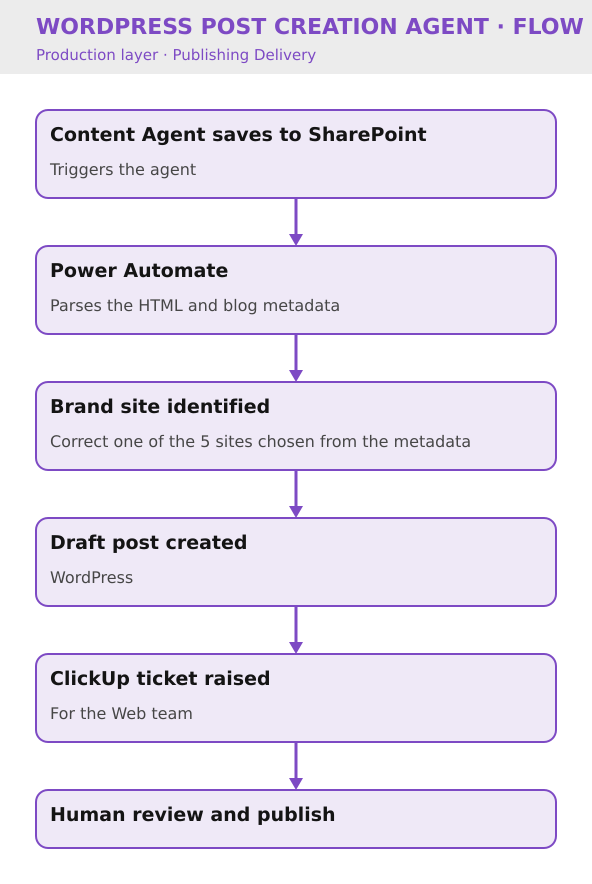

# WordPress Post Creation Agent

Key Result: 12 hours/month saved via automation
Layer: Production
Problem: Manual WordPress Post Creation
Status: Live

[Home](../../index.html) • [Agent Registry](../../Agent-Registry.html) • [Results](../../Results.html) • [Roadmap](../../Roadmap.html) • [Campaign & Commercial Projects](../../Campaign-Commercial-Projects.html) • [Leadership & Strategy](../../Leadership-%26-Strategy.html) • [How to Build MOCC](../../How-to-Build.html) • [HubSpot Expert in South Wales](../../HubSpot-Expert-South-Wales.html)

---

**Layer:** Production — Publishing Delivery 

**Status:** Live 

**Platform:** WordPress (five brand sites) · Power Automate · SharePoint · ClickUp 

**Deployment:** Veriforce — live on 5 brands 

**Last updated:** October 2026 

**Version:** 1.1

## Business Problem

Creating WordPress posts from finished HTML content was a manual task, requiring careful checking to publish to the correct brand site across a five-website estate. This carried a risk of content landing on the wrong website and added a recurring block of manual effort every month.

## Solution Overview

The WordPress Post Creation Agent takes HTML output (including content produced by the Content Agent) and creates the corresponding post in WordPress. The agent is triggered when the Content Agent saves a document to SharePoint. Power Automate parses the HTML and posts it to the correct brand website based on the blog metadata, saving it as a draft in WordPress. A ClickUp ticket is then created for the Web team to review and publish. The agent is live across all 5 brand websites.

## Business Value

- Removed manual WordPress post creation from the content pipeline
- Automated brand/site identification, reducing risk of publishing to the wrong website
- Retained a human review and publish step via a ClickUp ticket to the Web team
- Saved approximately **12 hours per month**
- Completes the automated pipeline from brief through to publish-ready WordPress post

### Cost Savings

- **Time reclaimed:** 12 hrs/month = £300/month = **£3,600/year** at the MOCC's illustrative £25/hour rate
- **Secondary benefit:** Developers freed from routine posting work; can focus on feature development

## Version History

| Version | Date | Milestone |
| --- | --- | --- |
| v1.0 | September 2026 | HTML ingestion, brand identification and ClickUp review ticket live (1 brand test) |
| v1.1 | October 2026 | Rolled out across all 5 brand websites |

## Design Insights

Automating brand identification removed the most error-prone step in the manual process, while keeping a human review and publish gate via ClickUp preserved editorial and quality control.

Pairing this agent with the Content Agent created an end-to-end pipeline from brief to publish-ready post, with human sign-off retained at both the drafting and publishing stages.

---

## Explore Other MOCC Modules

- [Agent Intake & Approval Agent](../Agent%20Intake%20%26%20Approval%20Agent/Agent-Intake-%26-Approval-Agent.html)
- [Campaign Build Agent](../Campaign%20Build%20Agent/Campaign-Build-Agent.html)
- [Content Agent](../Content%20Agent/Content-Agent.html)
- [Clarity Website Analyst](../Clarity%20Website%20Analyst/Clarity-Website-Analyst.html)
- [Email QA Agent](../Email%20QA%20Agent/Email-QA-Agent.html)
- [Website QA Agent](../Website%20QA%20Agent/Website-QA-Agent.html)
- [Data Import Agent](../Data%20Import%20Agent/Data-Import-Agent.html)
- [CRM Health Agent](../CRM%20Health%20Agent/CRM-Health-Agent.html)
- [Campaign Performance Agent](../Campaign%20Performance%20Agent/Campaign-Performance-Agent.html)
- [Agent Health Monitor](../Agent%20Health%20Monitor/Agent-Health-Monitor.html)
